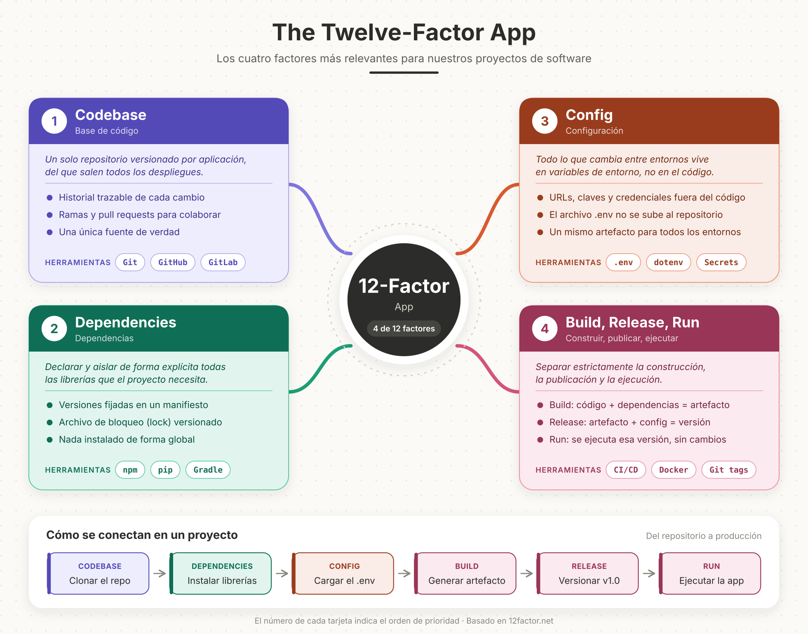

# The Twelve-Factor App: factores seleccionados

## Factores elegidos

1. **Codebase** (Base de código)
2. **Dependencies** (Dependencias)
3. **Config** (Configuración)
4. **Build, Release, Run** (Construir, publicar, ejecutar)

## Justificación

Elegí Codebase, Dependencies, Config y Build/Release/Run, ya que considero que son la base para que cualquier proyecto de software se pueda construir, compartir y corregir sin depender exclusivamente de la computadora de una persona.

Codebase establece un único repositorio versionado por aplicación, del cual salen todos los entornos. Esto nos da una única fuente de verdad: donde cada cambio queda registrado, ademas de  sabe quién lo hizo y cuándo, y se evita que circulen copias del código que terminan divergiendo entre compañeros trabajo.

Dependencies exige declarar de forma explícita las librerías y versiones que el proyecto necesita para funcionar, junto con su archivo de bloqueo. Así, quien clone el repositorio en un equipo nuevo obtiene exactamente el mismo entorno, y desaparece el clásico “en mi equipo sí funciona”.

Config separa del código todo lo que cambia entre entornos, como es el caso de las URLs, credenciales y claves de API, y lo guarda en variables de entorno. El archivo local con esos valores no se versiona, porque si se tiene acceso  a estos valores dentro del repositorio o de su historial queda expuesto a que cualquiera tenga acceso. Además, permite usar el mismo artefacto en desarrollo, pruebas y producción cambiando solo la configuración.

Por último, Build/Release/Run el cual divide el ciclo en tres etapas: el build convierte el código y sus dependencias en un artefacto ejecutable, el release lo combina con una configuración concreta y le asigna una versión inmutable, y el run lo ejecuta en el entorno destino. Gracias a esta separación podemos desplegar una versión fija para una demo o una entrega, saber con certeza qué se ejecutó en cada momento y volver a un release anterior si una actualización falla, sin reconstruir nada a mano.

## Resumen

| # | Factor | Idea principal | Ventaja clave |
|---|--------|----------------|---------------|
| 1 | Codebase | Un repositorio por aplicación | Fuente única de verdad y trazabilidad |
| 2 | Dependencies | Dependencias declaradas y con versión fija | Entornos reproducibles en cualquier equipo |
| 3 | Config | Configuración en variables de entorno | Seguridad y un mismo artefacto para todos los entornos |
| 4 | Build, Release, Run | Etapas separadas y releases versionados | Despliegues confiables y rollback rápido |
